# 🚍 TransMi — Investigación aplicada en movilidad urbana para Bogotá

<p align="center">
  <strong>Un proyecto de investigación con fines educativos: ¿cómo sería una app de transporte público si se diseñara hoy, desde cero? TransMi es una aplicación web progresiva sobre los datos en vivo de TransMilenio y el SITP, con planeador de viajes, buses en vivo, un copiloto que te avisa antes de tu parada, un asistente con IA y un servidor MCP para usarla desde Claude, ChatGPT o Gemini.</strong>
</p>

<p align="center">
  
  
  
  
  
  
  
  
</p>

<p align="center">
  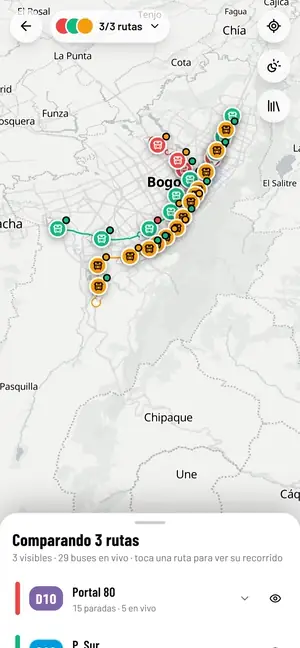
</p>

<p align="center">
  <a href="#-demo">🎬 Demo</a> ·
  <a href="#-preguntas-de-investigación">🔬 Preguntas de investigación</a> ·
  <a href="#-transmi-en-tu-ia-servidor-mcp">🔌 Servidor MCP</a> ·
  <a href="#️-arquitectura">🏗️ Arquitectura</a> ·
  <a href="#-cómo-citar">📚 Cómo citar</a>
</p>

> [!IMPORTANT]
> **Proyecto independiente, educativo y sin fines comerciales.** No es la [app oficial de TransMilenio](https://play.google.com/store/apps/details?id=com.nexura.transmilenio&hl=es_CO) ni busca reemplazarla o competir con ella. Los datos de rutas y estaciones pertenecen a TransMilenio S.A.

---

## 📄 Resumen

TransMi nació como un ejercicio para aprender a integrar APIs de mapas, diseñar interfaces mobile-first y consumir datos de transporte público. Al usar la app oficial surgió una pregunta: *¿qué tendría una app de transporte si se diseñara hoy, desde cero?* La versión 3 es un prototipo funcional que explora esa pregunta con datos reales.

El proyecto prueba ideas concretas. Una app web, sin tienda de aplicaciones, puede avisarte antes de tu parada aunque tengas el teléfono bloqueado. Puedes compartir tu viaje en vivo sin compartir la ubicación de tu celular. Un asistente de IA responde mejor cuando consulta datos en vivo en lugar de responder de memoria. Y los asistentes que la gente ya usa, como Claude, ChatGPT o Gemini, pueden consultar el transporte de una ciudad a través del protocolo MCP, sin instalar nada nuevo.

---

## 🔬 Preguntas de investigación

| Pregunta | Qué propone TransMi | Dónde verlo |
|---|---|---|
| ¿Puede una app web avisarte antes de tu parada con el teléfono bloqueado? | El teléfono congela las apps web en segundo plano, así que el **servidor sigue el bus en que vas** con los datos en vivo y te envía una notificación push antes de bajarte | [Modo viaje](#️-modo-viaje-viaje) |
| ¿Se puede compartir un viaje en vivo sin compartir tu ubicación? | El teléfono reconoce en qué bus vas (dos lecturas seguidas a menos de 150 m de un bus de la ruta) y el enlace **sigue a ese bus**, no a tu celular | [Sigue mi viaje](#️-modo-viaje-viaje) |
| ¿Qué cambia cuando un asistente de IA consulta datos reales en lugar de responder de memoria? | Un agente con **15 herramientas** sobre los datos en vivo responde con tarjetas que se pueden usar: itinerarios que se inician con un toque y tableros de llegadas | [Asistente](#-asistente-con-ia-asistente) |
| ¿Pueden los asistentes que la gente ya usa consultar el transporte de una ciudad? | Las mismas herramientas expuestas como **servidor MCP**, sin cuenta ni clave, para Claude, ChatGPT, Gemini y cualquier cliente MCP | [Servidor MCP](#-transmi-en-tu-ia-servidor-mcp) |
| ¿Cómo diseñar para planes prepago, teléfonos lentos y personas con baja visión? | Ahorro de datos (mapas bajo pedido, la mitad de consultas), tamaño de letra y más contraste | [Para todos los días](#-para-todos-los-días) |
| ¿Cómo se ve un sistema de transporte con señalética clara y color con significado? | Interfaz monocroma donde el único color viene de los datos: troncales, rutas y ocupación | [Diseño](#-diseño) |

---

## 🎬 Demo

Grabado con datos en vivo: los buses, las llegadas y el clima son reales. Casa, Trabajo y la tarjeta TuLlave son datos de demostración. Las vistas previas van aceleradas.

<p align="center">
  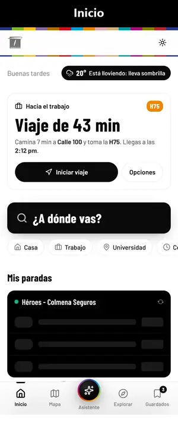
  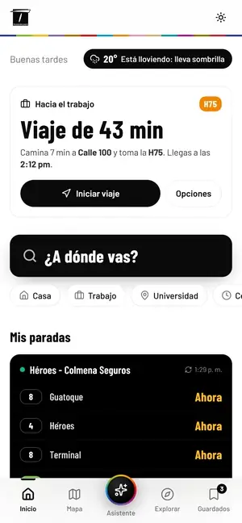
  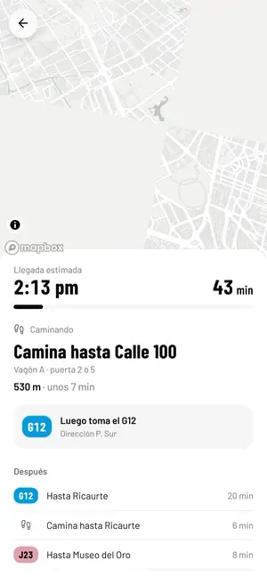
</p>

<p align="center">
  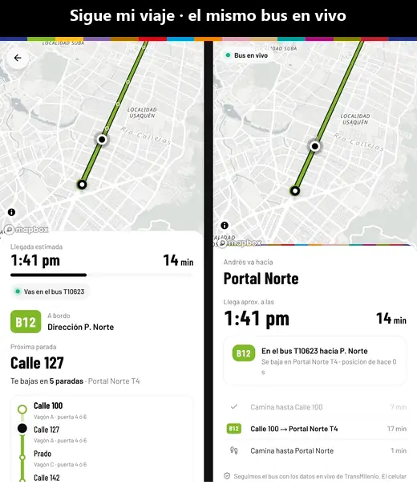
  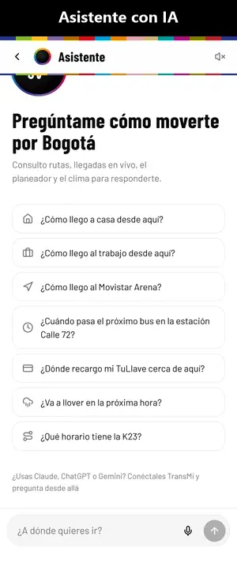
</p>

<p align="center">
  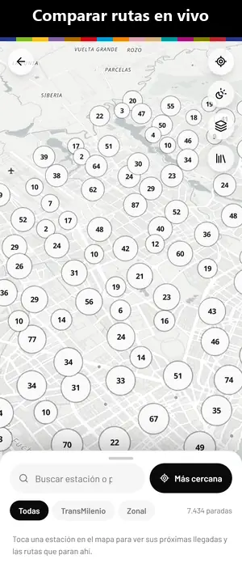
  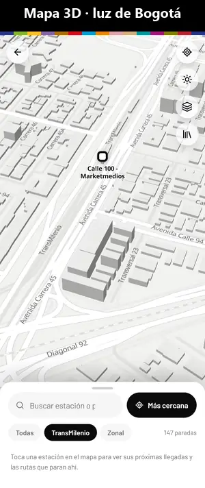
  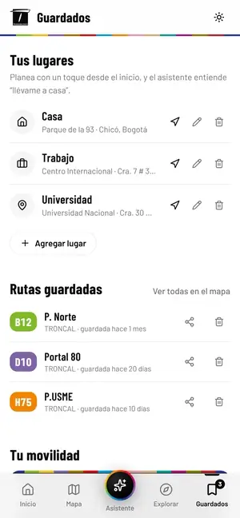
</p>

<p align="center">
  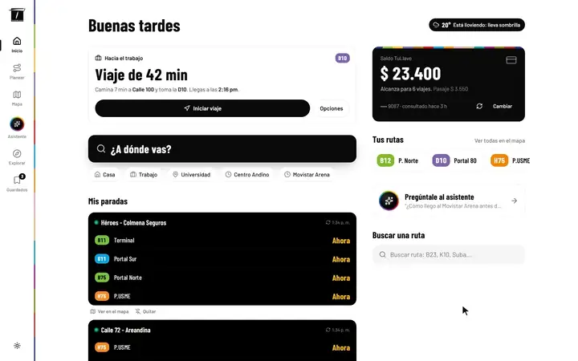
</p>

---

## 🏗️ Arquitectura

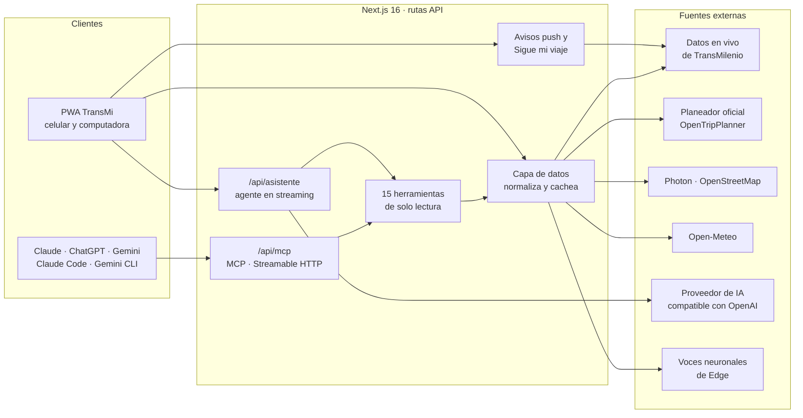

- **Un solo conjunto de herramientas**: el asistente de la app y el servidor MCP usan las mismas 15 herramientas ([`src/lib/server/assistant/tools.ts`](src/lib/server/assistant/tools.ts)); un cambio en una llega a los dos.
- **La capa de datos** normaliza las respuestas de los servicios en vivo (ocupación, rumbo, horarios) y las cachea por tiempo, para no consultar dos veces lo mismo.
- **Tus datos viven en tu teléfono**: lugares, viajes, rutina, ajustes y tarjeta se guardan en el navegador. De lo tuyo, el servidor solo guarda los viajes que compartes y los avisos activos.
- **El mapa** usa Mapbox (estilo Standard en 3D) y cambia solo a OpenFreeMap si Mapbox rechaza las teselas.

---

## ✨ Funcionalidades

### 🏠 Inicio
- **Tu rutina**: aprende tus viajes frecuentes (y usa Casa/Trabajo) para decirte **"Sal en 6 min"**, sumando la caminata y el próximo bus en la dirección correcta
- **Mis paradas**: fija las estaciones que usas a diario y mira sus llegadas en vivo apenas abres la app
- **Instalar TransMi**: aviso para agregarla a la pantalla de inicio (Android e iPhone)
- **¿A dónde vas?**: un toque para planear, con accesos a Casa, Trabajo, lugares guardados y recientes
- **Cerca de ti**: la estación de **TransMilenio** o el paradero del **SITP** más cercano (eliges cuál; recuerda tu elección) con un **tablero de llegadas en vivo** (animación tipo split-flap), y los otros paraderos a pocos pasos, como el del otro lado de la calle
- **Clima** de Bogotá con aviso de **"lluvia en ~N min"**
- **Saldo TuLlave** con cuántos viajes alcanzan según la tarifa vigente; descuenta los viajes hechos desde la última consulta y, cuando el saldo es bajo, muestra el **punto de recarga más cercano abierto ahora** (con su horario, festivos incluidos). Tu rutina también avisa si no alcanza para el pasaje

### 🧭 Planeador de viajes (`/planear`)
- Origen y destino con búsqueda de lugares (OpenStreetMap), estaciones, tu ubicación y lugares guardados
- Itinerarios del planeador oficial (OpenTripPlanner) con barra de tramos proporcional al tiempo, transbordos y caminata
- Etiquetas **Más rápida / Menos transbordos / Menos caminata** y aviso del **próximo bus** en la estación de abordaje
- Detalle con mapa, paso a paso y paradas intermedias

### 🛰️ Modo viaje (`/viaje`)
- Progreso en vivo sobre el **diagrama de la línea**, próxima parada y hora estimada de llegada
- **Despiértame**: vibración, sonido, voz y notificación N paradas antes de bajarte (las frases se sintetizan por adelantado para sonar al instante)
- **Avisos con la app cerrada**: el teléfono congela las apps web en segundo plano, así que el servidor sigue **el bus en que vas** (datos en vivo de TransMilenio, nunca tu ubicación) y te envía una **notificación push** antes de tu parada y al llegar, con el siguiente paso si haces transbordo. Basta con tener TransMi abierta hasta que reconozca tu bus; si no lo reconoce, avisa una vez según el tiempo estimado. En iPhone requiere TransMi instalada en la pantalla de inicio (iOS 16.4+)
- **Sigue mi viaje**: comparte un **enlace corto** (`/sigue/Xk3a9Qz2Lp`) por la app que quieras; quien lo abre ve **tu bus moviéndose en vivo**, tu hora de llegada y **el siguiente bus si haces transbordo**. Se sigue al bus (datos en vivo de TransMilenio), nunca la ubicación de tu celular: el teléfono solo informa en qué tramo y en qué bus vas. Los viajes se guardan como archivos en `.data/` (configurable con `DATA_DIR`) y se borran a los 3 días
- Pantalla siempre encendida (Wake Lock) y modo simulación (`/viaje?demo=1`) para probar sin moverse

### 🗺️ Mapa en vivo (`/mapa`)
- Mapbox **Standard monocromo en 3D**, con luz real del cielo de Bogotá (amanecer, día, atardecer, noche)
- **Trazado real** de cada ruta y **buses que se desplazan suavemente**, con **ocupación** (vacío / medio / lleno) y accesibilidad
- **Diagrama de línea** estilo metro con los buses moviéndose entre estaciones y tiempos de llegada por parada
- Comparación de varias rutas (multi-ruta), estaciones con llegadas en vivo y capas de **puntos de recarga** y **personalización** TuLlave

### ✨ Asistente con IA (`/asistente`)
- Conversación en español con **cualquier proveedor compatible con el estándar de chat completions** (Groq, Xiaomi MiMo, OpenRouter, DeepSeek, Ollama…) y herramientas sobre los datos reales: buscar lugares, planear viajes, rutas (también por estación), troncales, zonas del SITP, llegadas, buses en vivo, saldo TuLlave, recargas abiertas ahora, viajes compartidos, clima y tarifa
- Respuestas con **tarjetas interactivas** (itinerarios que se inician con un toque, tableros de llegadas, rutas)
- **Dictado por voz** (es-CO) y lectura en voz alta con voces neuronales
- Se queda en el tema: además de las instrucciones del modelo, un filtro corta cualquier respuesta que no sea sobre moverse por Bogotá (p. ej. código)

### 🔌 Conéctala a tu IA
- Las mismas herramientas del asistente, como **servidor MCP** para Claude, ChatGPT, Gemini y otros clientes. Detalles en [TransMi en tu IA](#-transmi-en-tu-ia-servidor-mcp)

### 🔍 Explorar y ⭐ Guardados
- Búsqueda de rutas con comparación en el mapa, troncales como diagrama de línea, zonas y paradas con llegadas en vivo
- Casa, Trabajo y lugares propios; rutas guardadas; estadísticas de **tu movilidad** (viajes, horas, km, CO₂ evitado estimado); ajustes de tema, luz del mapa, alarma y **voz** (Ava, Emma, Andrew o Brian, con muestra)

### 🎨 Diseño
- **Monocromo + color con significado**: la interfaz es negra y blanca; el único color viene de los datos (colores de troncales y rutas, ocupación)
- Tipografía de señalética: **Barlow** y **Barlow Condensed**
- **Franja del sistema**: firma visual con los 15 colores oficiales de las troncales
- Modo claro, oscuro o del sistema, sin parpadeo al cargar
- **Versión para computadora** (desde 1024 px): barra de navegación vertical con la franja del sistema como eje; mapa con panel lateral; planeador con las opciones a la izquierda y la ruta en el mapa a la derecha (al pasar el cursor por una opción se dibuja); copiloto e inicio en dos columnas. En el celular nada cambia

### 📶 Para todos los días
- **Ahorro de datos** (se activa solo si el teléfono lo pide): mapas planos y bajo pedido (mientras tanto, un **esquema del recorrido dibujado sin descargar nada**), datos en vivo con la mitad de consultas y avisos con la voz del teléfono. El catálogo de 7.400 paradas se guarda un mes en el teléfono
- **Tamaño de letra** (Normal, Grande, Muy grande) y **Más contraste**; la app sigue además el tamaño de letra y el contraste del teléfono
- **Festivos de Colombia** calculados en el teléfono (Ley Emiliani y Semana Santa): horarios de rutas, rutina y puntos de recarga usan el horario de domingos y festivos

---

## 🔌 TransMi en tu IA: servidor MCP

TransMi publica sus herramientas como un servidor [MCP (Model Context Protocol)](https://modelcontextprotocol.io) en `/api/mcp`. Así puedes preguntarle a Claude, ChatGPT o Gemini cómo moverte por Bogotá y te responden con los datos en vivo de TransMi, sin instalar otra app.

**Cómo está hecho**

- **Streamable HTTP sin estado**: cada solicitud crea su propio servidor y lo cierra al responder. No hay sesiones que mantener ([`src/app/api/mcp/route.ts`](src/app/api/mcp/route.ts)).
- **Solo lectura y sin cuenta**: las 15 herramientas consultan datos públicos y se marcan como de solo lectura. No se necesita clave.
- **Instrucciones para el modelo**: no inventar rutas ni horarios, preguntar dónde está la persona (el servidor no conoce su ubicación) y no repetir completo el número de la tarjeta TuLlave ([`src/lib/server/mcp.ts`](src/lib/server/mcp.ts)).
- **Enlaces de vuelta a la app**: cada viaje planeado trae un enlace que lo abre en el planeador de TransMi.

**Herramientas**

| Herramienta | Qué hace |
|---|---|
| `buscar_lugar` | Busca sitios, barrios, direcciones y estaciones de Bogotá |
| `planear_viaje` | Planea un viaje entre dos puntos con el planeador oficial |
| `buscar_rutas` | Busca rutas por código o nombre y dice si operan ahora |
| `detalle_ruta` | Recorrido completo, horarios y si opera ahora |
| `rutas_estacion` | Rutas que paran en una estación o paradero |
| `troncales` | Troncales de TransMilenio y sus estaciones en orden |
| `zonas_sitp` | Zonas del SITP y sus rutas zonales |
| `llegadas_estacion` | Próximos buses en vivo de una estación o paradero |
| `buses_en_vivo` | Cuántos buses de una ruta circulan ahora y qué tan llenos van |
| `estaciones_cercanas` | Estaciones y paraderos más cercanos a un punto |
| `puntos_recarga_cercanos` | Puntos de recarga o personalización TuLlave, con horario y si están abiertos |
| `consultar_saldo` | Saldo de una tarjeta TuLlave y para cuántos viajes alcanza |
| `seguir_viaje` | Cómo va un viaje compartido con "Sigue mi viaje" |
| `clima` | Clima actual y si va a llover en las próximas 2 horas |
| `tarifa` | Valor actual del pasaje |

**Pregúntale, por ejemplo**

- *¿Cómo llego de Portal Norte a Unicentro si salgo a las 6 p. m.?*
- *¿Cuándo pasa la B13 por la Calle 72?*
- *¿Qué tan llena va la K23 ahora?*
- *¿Cuánto saldo tiene mi TuLlave? Y si está bajo, ¿dónde recargo cerca del Parque de la 93?*
- *¿Mi hermana ya casi llega? Me mandó este enlace de Sigue mi viaje…*

**Cómo conectarla**

La pantalla **`/conectar`** (enlazada desde Guardados y el asistente) explica los pasos con la dirección del sitio lista para copiar.

- **Claude (web o escritorio)**: *Configuración → Conectores → Agregar conector personalizado* y pega `https://tu-dominio/api/mcp`. Después también funciona en la app del celular
- **ChatGPT** (plan de pago, desde la web): activa *Configuración → Apps y conectores → Avanzado → Modo desarrollador*, luego *Crear*, pega la URL y elige *Sin autenticación*. En cada chat se activa desde *+ → Más → Modo desarrollador*
- **Gemini** (por ahora solo en EE. UU., en inglés y con cuenta personal de Google): en gemini.google.com, *Settings → Connected Apps → Add a custom app* y pega la URL. En el chat se usa con *@TransMi*
- **Claude Code**: `claude mcp add --transport http transmi https://tu-dominio/api/mcp`. Sirve cualquier otro cliente MCP por HTTP
- **Gemini CLI**: `gemini mcp add --transport http transmi https://tu-dominio/api/mcp`. Necesita una clave de API de Gemini: Google ya no lo atiende con la cuenta personal gratuita
- Las apps se conectan desde sus servidores, así que la URL debe ser pública y con https. Para probar en local usa Claude Code con `http://localhost:3000/api/mcp`

---

## 🔒 Privacidad y decisiones de diseño

- **Se sigue al bus, no al teléfono.** Para *Sigue mi viaje* y los avisos con la app cerrada, el teléfono solo informa en qué tramo y en qué bus vas; la posición que ven los demás es la del bus, con los datos en vivo de TransMilenio.
- **La rutina se calcula en el teléfono.** "Tu rutina" adivina a dónde vas con tus viajes terminados y tu Casa/Trabajo, sin enviar tu historial a ningún servidor.
- **Lo que guarda el servidor dura poco.** Los viajes compartidos se borran a los 3 días, y crear enlaces o avisos tiene un límite de solicitudes por dirección IP.
- **El asistente no se sale del tema**, y las herramientas MCP son de solo lectura y no conocen la ubicación de quien pregunta.

---

## 🧪 Cómo se construyó y se probó

- **75 pruebas con Vitest** en 12 archivos sobre la lógica que no se ve: rutina, saldo y viajes que alcanzan, festivos, ahorro de datos, dirección de los buses, geometría, enlaces compartidos, avisos push, el servidor MCP y el alcance del asistente (`pnpm test`).
- **Modo simulación** (`/viaje?demo=1`) para recorrer un viaje completo sin moverse, con avisos y voz.
- **`GET /api/asistente?probar=1`** verifica la conexión con el proveedor de IA y que el modelo sepa llamar herramientas.
- **Los videos del demo** se grabaron sobre la app funcionando con datos en vivo; *Sigue mi viaje* siguió un bus B12 real.

---

## ⚠️ Limitaciones

- **Fuentes no garantizadas**: los datos en vivo vienen de los servicios que usa la app oficial. No son una API pública con garantías, así que pueden cambiar o dejar de responder. Fuera de Colombia se necesita un proxy (`PROXY_BASE`).
- **El GPS de los buses llega con unos segundos de retraso**, por eso reconocer tu bus exige dos lecturas seguidas cerca de él.
- **El asistente depende del modelo**: con destinos sin una ruta directa (por ejemplo, Monserrate) puede tardar o proponer primero una opción poco útil.
- **Disponibilidad de los clientes MCP**: ChatGPT lo permite solo en planes de pago, y Gemini por ahora solo en EE. UU.
- **Sin estudios con usuarios**: es un prototipo de investigación. Sus decisiones de diseño no se han validado con pruebas de usabilidad.

---

## 🛠️ Stack Tecnológico

| Tecnología | Uso |
|---|---|
| **Next.js 16** | App Router, rutas API como capa de datos y proxy |
| **React 19** | UI con hooks |
| **TypeScript 5** | Tipado estático |
| **Tailwind CSS 4** | Sistema de diseño con tokens |
| **Mapbox GL JS 3** | Estilo Standard monocromo, 3D, capas GeoJSON |
| **Cliente `openai` + Zod** | Asistente con herramientas en streaming sobre cualquier API compatible (host + clave + modelo) |
| **SDK de MCP** | Servidor MCP (Streamable HTTP) con las herramientas del asistente |
| **Zustand** | Estado persistente (favoritos, lugares, viajes, ajustes) con migración desde v2 |
| **Motion** | Paneles inferiores arrastrables |
| **Open-Meteo / Photon** | Clima y búsqueda de lugares sin clave |
| **@andresaya/edge-tts** | Voces neuronales de Microsoft Edge (multilingües, en español de Colombia) servidas por `/api/voz` con caché |
| **web-push** | Notificaciones push con la app cerrada |
| **Vitest** | Pruebas de la lógica |

---

## 📁 Estructura del Proyecto

```
src/
├── app/
│   ├── page.tsx              # Inicio
│   ├── planear/              # Planeador A→B
│   ├── viaje/                # Modo viaje (copiloto)
│   ├── mapa/                 # Mapa en vivo
│   ├── asistente/            # Chat con IA
│   ├── explorar/             # Rutas, troncales, zonas, paradas
│   ├── favoritos/            # Guardados, movilidad y ajustes
│   ├── conectar/             # Cómo usar TransMi desde Claude, ChatGPT o Gemini (MCP)
│   └── api/
│       ├── plan/             # Planeador (OpenTripPlanner oficial)
│       ├── geocode/          # Lugares y dirección inversa
│       ├── llegadas/         # Llegadas en vivo por estación/paradero
│       ├── live/             # Buses en vivo normalizados (ocupación, rumbo)
│       ├── eta/              # Próximos buses de una ruta en una parada
│       ├── routes/detail/    # Ruta con trazado real y paradas
│       ├── stations/         # Estaciones (+ /nearby)
│       ├── puntos/           # Puntos de recarga y personalización
│       ├── clima/  info/     # Clima y tarifa
│       ├── sigue/            # Enlaces cortos de "Sigue mi viaje"
│       ├── avisos/           # Avisos push con la app cerrada
│       ├── asistente/        # Asistente (streaming NDJSON)
│       └── mcp/              # Servidor MCP para Claude, ChatGPT, Gemini y otros clientes
├── components/
│   ├── transit/              # RouteBadge, LineDiagram, ArrivalBoard, SegmentBar…
│   ├── mapa/  plan/  trip/   # Piezas de cada experiencia
│   ├── assistant/            # Chat, tarjetas, voz
│   └── home/  places/  brand/  layout/  ui/
├── lib/
│   ├── server/               # Clientes upstream, normalizadores, asistente, MCP, avisos (tripAlerts/)
│   ├── geo.ts  schedule.ts  color.ts  mapbox.ts
├── stores/app.ts             # Estado persistente
└── hooks/                    # useLiveData, useGeolocation…
docs/media/                   # Vistas previas animadas del README
```

---

## 🚀 Instalación y Uso

```bash
pnpm install
cp .env.example .env.local   # completa las variables
pnpm dev                     # http://localhost:3000
pnpm test                    # pruebas de la lógica (Vitest)
```

### Variables de entorno

| Variable | Requerida | Descripción |
|---|---|---|
| `NEXT_PUBLIC_MAPBOX_TOKEN` | ✅ Sí | Token de [Mapbox](https://account.mapbox.com/access-tokens/) para el mapa |
| `BUS_API_TOKEN` | ❌ Opcional | Token del proxy (`x-auth-token`) para los datos en vivo |
| `PROXY_BASE` | ❌ Opcional | Proxy para la API en vivo cuando se despliega fuera de Colombia |
| `AI_BASE_URL` | ❌ Opcional | Host de una API compatible (p. ej. `https://api.groq.com/openai/v1`, `https://api.xiaomimimo.com/v1`) |
| `AI_API_KEY` | ❌ Opcional | Clave de ese proveedor (vacía para servidores locales como Ollama) |
| `AI_MODEL` | ❌ Opcional | Modelo con soporte de *tools* (p. ej. `openai/gpt-oss-120b` en Groq, `mimo-v2.6-flash` en MiMo) |
| `AI_FALLBACK_BASE_URL` · `_API_KEY` · `_MODEL` | ❌ Opcional | Segundo proveedor que responde si el principal falla |
| `AI_REASONING_EFFORT` · `AI_MAX_TOKENS` | ❌ Opcional | Parámetros estándar, solo se envían si los defines |
| `NEXT_PUBLIC_MAP_PROVIDER` | ❌ Opcional | `mapbox` o `openfreemap`. Sin definir: Mapbox, con cambio automático a OpenFreeMap si Mapbox rechaza las teselas |
| `DATA_DIR` | ❌ Opcional | Carpeta de los viajes compartidos y de los avisos (por defecto `./.data`) |
| `VAPID_PUBLIC_KEY` · `VAPID_PRIVATE_KEY` | ❌ Opcional | Llaves de las notificaciones push. Sin definir, se generan solas la primera vez y se guardan en `DATA_DIR/vapid.json` |
| `VAPID_SUBJECT` | ❌ Opcional | Contacto para los servicios push (`mailto:…` o `https://…`). Por defecto, la dirección https del sitio |

Para verificar la conexión y que el modelo llame herramientas: `GET /api/asistente?probar=1`.

#### Sobre `PROXY_BASE`

Las rutas que consultan datos en vivo (`/api/live`, `/api/llegadas`, `/api/eta`, `/api/puntos`, `/api/saldo`…) usan `PROXY_BASE` si está definido:

```
PROXY_BASE?url=https://tmsa-transmiapp-shvpc.uc.r.appspot.com/endpoint
```

El planeador (`/api/plan`) siempre llama directo: el servicio de planeación rechaza las solicitudes que llegan por el proxy.

---

## 🎓 Aprendizajes Clave

1. **Mapbox GL 3**: estilo Standard configurable, capas por *slot*, interpolación de marcadores
2. **Next.js App Router**: rutas API como capa de normalización con caché por TTL
3. **IA aplicada**: un agente con herramientas sobre datos reales, en streaming, con tarjetas de UI
4. **Protocolo MCP**: las mismas herramientas del agente, publicadas para que otros asistentes las usen
5. **APIs del navegador**: geolocalización continua, Wake Lock, vibración, voz (Speech Synthesis / Recognition), notificaciones push
6. **Diseño de sistemas**: señalética, color con significado y un diagrama de línea como pieza central

---

## 📚 Cómo citar

Si usas TransMi como referencia en un trabajo académico, puedes citarlo así (GitHub también ofrece *Cite this repository* a partir de [`CITATION.cff`](CITATION.cff)):

```bibtex
@software{transmi,
  author = {andresayac},
  title  = {TransMi: investigación aplicada en movilidad urbana para Bogotá},
  url    = {https://github.com/andresayac/transmi-app},
  note   = {Proyecto educativo independiente; no es la app oficial de TransMilenio}
}
```

---

## 📄 Licencia

Este proyecto es de uso **exclusivamente educativo**. No cuenta con licencia comercial. Los datos y la marca TransMilenio pertenecen a **TransMilenio S.A.**

---

<p align="center">
  <em>Hecho con ❤️ como proyecto de investigación y aprendizaje — Bogotá, Colombia 🇨🇴</em>
</p>
